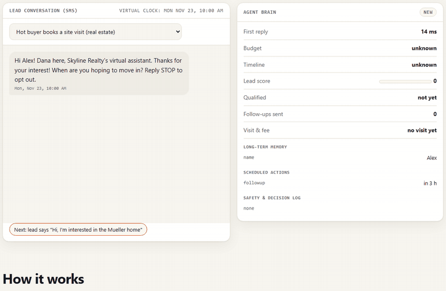
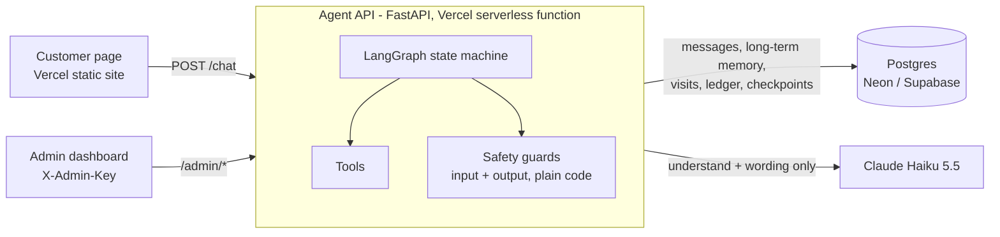
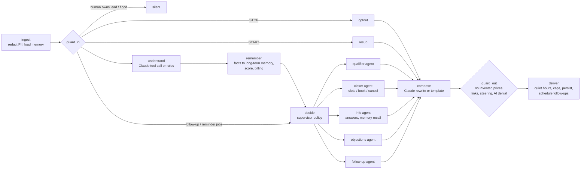

# Dead Closer

An AI sales agent for **real-estate agencies** (site visits) and **car dealers** (test drives). It answers every new lead in seconds, qualifies **budget and timeline**, follows up for weeks, books the visit, and earns a flat fee **only when a qualified visit is booked**.



| | |
|---|---|
| **Live website** (customer chat, admin dashboard, demo) | https://dead-closer.vercel.app |
| **Agent API base URL** (`POST /chat`, `GET /health`) | https://dead-closer.vercel.app |
| Static mirror (GitHub Pages) | https://fastiantaha23.github.io/dead-closer/ |
| Benchmarks | [RESULTS.md](RESULTS.md) |
| Own test cases | [tests.json](tests.json) (10 cases, runner in `scripts/run_tests_json.py`) |

## Workshop checklist

| Must-have | Where it is |
|---|---|
| Customer page + admin dashboard | `deadcloser/web/chat.html` (customer chat), `admin.html` (users, memory, visits, fees, decision log), `index.html` (landing + demo + benchmarks) |
| LangGraph agent, >= 2 agents/nodes | `deadcloser/graph.py`: 10 nodes (ingest, guard_in, understand, remember, decide, compose, guard_out, deliver, optout, resub) and a supervisor routing to the **qualifier, closer, info, objections and follow-up agents** (`deadcloser/agents/`) |
| >= 2 real tools | `search_inventory`, `check_availability`, `book_visit`, `cancel_visit`, `save_memory`, `recall_memory` (`deadcloser/tools.py`); every call is returned in `tool_calls` |
| Short-term memory by `thread_id` | LangGraph checkpointer, one checkpoint thread per `(user, thread_id)`; rolling window + running summary |
| Long-term memory by `user_id` | per-user facts, preferences, notes and episodes in Postgres (`memories` + `leads`) |
| Users never see each other's data | every query scoped by `user_id`/tenant; tested in the engine, over HTTP and on real Postgres |
| Safety | refuses off-topic and prompt injection, asks YES before cancelling or booking an un-offered time, STOP/START, PII redaction, no invented prices/promises, fair-housing guard |
| Model | `claude-haiku-5-5` (`DEADCLOSER_MODEL`), at most 2 small calls per message; compliance/slot messages use exact templates with no model call |
| `POST /chat`, `GET /health` | open, no login; `/chat` returns exactly `{reply, tool_calls, tokens}`, `/health` returns `ok` |
| Hosted Postgres memory | `DATABASE_URL` (Neon); nothing important is in process memory |
| `.env.example`, `tests.json`, benchmark table, memory note | in this repo, below |

## Architecture





**Design rule: the model never decides, it only reads and words.** Which action to take, which tool to call and whose data to touch are plain code. Claude turns the lead's text into structured fields (one tool call) and rewrites an already-decided plan in a friendlier voice. Every output passes the same deterministic guard, and any model failure (timeout, refusal, bad output) falls back to a template, so the user always gets an answer.

## Memory design note

| | Short-term | Long-term |
|---|---|---|
| **Scope** | one conversation = one `thread_id` | one person = one `user_id`, across all threads |
| **What goes in it** | the rolling message window (last 14 messages) + a running summary of older turns; pending question (`awaiting`), offered visit slots | name, budget, timeline, bedrooms/body/area/feature preferences, the listing they like, booked/cancelled visits, free-text notes ("I have two dogs"), per-business follow-up playbook |
| **Where it is stored** | LangGraph `PostgresSaver` checkpoint (`thread_id` = `tenant:user:thread`), plus the `messages` table tagged with `thread_id` | Postgres tables `leads` (typed fields) and `memories` (key/value facts), written by the `save_memory` tool |
| **Survives restart** | yes (Postgres) | yes (Postgres) |
| **How users are separated** | the checkpoint thread id embeds the user; messages are queried by `lead_id` + `thread_id` | every query has `tenant_id` and the user's lead row; `user_id` is unique per tenant; the model never supplies an id; PII is redacted before storage |
| **Read by** | `ask_recap` ("what did I just ask?"), the model prompt (last 6 turns) | `ask_memory` ("what do you know about me?"), qualification, personalised greeting for a returning user |

A new `thread_id` for the same `user_id` starts a clean conversation (no pending question, no transcript) but the agent greets the user back and still knows their budget, timeline, preferences and notes.

## Setup

```bash
git clone https://github.com/fastiantaha23/dead-closer && cd dead-closer
python -m venv .venv && source .venv/bin/activate          # Windows: .venv\Scripts\activate
pip install -r requirements-dev.txt
cp .env.example .env                                         # fill in ANTHROPIC_API_KEY, DATABASE_URL, DEADCLOSER_ADMIN_KEY
export $(grep -v '^#' .env | xargs)                          # or set the variables in your shell
uvicorn deadcloser.api:app_factory --factory --port 8000    # http://localhost:8000  (site)  /docs (OpenAPI)
```

Without `ANTHROPIC_API_KEY` the agent runs on its offline rules engine; without `DATABASE_URL` it uses local SQLite files.

```bash
curl localhost:8000/health                                   # -> ok
curl -X POST localhost:8000/chat -H "Content-Type: application/json" \
  -d '{"user_id":"sam","thread_id":"t1","message":"Hi, I am Sam, budget 480k, moving in 2 months"}'
# -> {"reply": "...", "tool_calls": [{"name":"save_memory",...}, {"name":"check_availability",...}], "tokens": {"in": 0, "out": 0}}

pytest -q                                                    # 77 tests (includes a real embedded Postgres)
python scripts/run_tests_json.py --local                     # tests.json against an in-process app
python scripts/run_tests_json.py --url https://<your-agent>  # ... or against a deployment
```

## Deploy (free tier)

Website and agent API ship as **one Vercel project** (static site in `public/`, the FastAPI app as a Python serverless function). The function is stateless: all memory is in Postgres, so cold starts and restarts lose nothing, and there is no sleeping free-tier server (Hugging Face Docker Spaces now need PRO and Render's free tier sleeps; `render.yaml` and `scripts/deploy_hf.py` remain as alternatives).

1. **Postgres (Neon or Supabase):** create a free project and copy the connection string (`postgresql://...?sslmode=require`). Tables and the LangGraph checkpoint tables are created automatically on first start.
2. **Assemble and deploy:**
   ```bash
   python scripts/build_vercel.py --repo https://github.com/YOUR_USER/dead-closer       # -> deploy/vercel
   cd deploy/vercel
   npx vercel link --yes --project dead-closer --token $VERCEL_TOKEN
   npx vercel git disconnect --yes --token $VERCEL_TOKEN                                 # deploy the bundle, not the repo root
   for k in DATABASE_URL ANTHROPIC_API_KEY DEADCLOSER_ADMIN_KEY; do printf '%s' "${!k}" | npx vercel env add $k production --sensitive --token $VERCEL_TOKEN; done
   printf claude-haiku-5-5 | npx vercel env add DEADCLOSER_MODEL production --token $VERCEL_TOKEN
   printf demo_realty      | npx vercel env add CHAT_TENANT production --token $VERCEL_TOKEN
   npx vercel deploy --prod --yes --token $VERCEL_TOKEN
   ```
3. **Check:** `curl https://<project>.vercel.app/health` -> `ok`; open `/chat.html` and `/admin.html` (admin key = `DEADCLOSER_ADMIN_KEY`); `python scripts/run_tests_json.py --url https://<project>.vercel.app`.

Secrets live only in Vercel environment variables (marked sensitive) - never in the repo.

## Benchmarks

Everything below runs offline on the rules engine (no model calls) - see [RESULTS.md](RESULTS.md) for methods, assumptions and caveats.

| What | Result | Kind |
|---|---|---|
| First-reply latency, whole engine | p50 **15 ms**, p95 **45 ms**, 100% inside the 60 s SLA | measured |
| Burst of 300 simultaneous leads (SQLite, one instance) | all answered in <= 1.6 s | measured |
| Budget / timeline read correctly (n = 639 / 643) | **96.9% / 93.8%** | measured vs ground truth |
| Safety suite (opt-out, injection, PII, fair housing, honesty, escalation, billing, isolation, off-topic, confirmation, robustness) | **118/118** (first run 92/100; bugs fixed) | measured, author-written |
| `tests.json` (own 10 cases) against the **live deployment** (Claude Haiku 5.5 + Neon) | **10/10**, median 1.1 s / p95 2.3 s per message | measured |
| 24 parallel users on the live deployment | 24/24 got their own data back, **0 cross-user leaks**, median 5-7 s under load | measured |
| Booking rate: full agent vs no follow-ups vs human-speed (4 h) reply | **30.6%** vs 19.5% vs 12.8% | simulated, assumed lead behaviour |
| Without qualification questions | 33.5% bookings but only 28% billable: **$423 vs $1,025** revenue per 100 leads | simulated |

## Safety, concretely

Off-topic requests are refused (and the conversation state is preserved); prompt injection is detected, logged and deflected - and since actions are not model-chosen there is nothing to hijack; **cancelling a visit or booking a time that was never offered requires an explicit YES**; PII (cards, SSNs, passwords) is redacted before it reaches the DB, checkpoint or model; prices are only quoted from inventory data; no promises about discounts, approvals or appreciation; neighbourhood/people questions are declined (fair housing); abuse, legal threats and distress hand over to a human; STOP unsubscribes (START resumes); proactive follow-ups only 9:00-20:00 local; a visit is billable only for a qualified lead, so the agent has no incentive to pad bookings.

## Honest limits

- The simulated conversion numbers rest on assumed lead behaviour - they compare variants, they do not predict real booking rates.
- **Claude Haiku 5.5 is a fallback parser plus a rewriter, not the decision-maker.** The deterministic parser handles most messages without any model call (about 0 tokens); Claude parses phrasing the rules cannot ("yo whats the damage on that place") and rewords answers. The safety suite and the simulation benchmark were run on the rules engine; `tests.json` and a parallel-user test were run live with Claude. Cost control: at most two calls per message, `effort: low`, no thinking for rewrites.
- Throughput: a Vercel function instance serialises CPU work; with 24 users at once the median message took 5-7 s (1.1 s when sequential).
- Off-topic and "what do you remember" detection are rule-based (explicit phrases + a domain-vocabulary check); unusual phrasings can slip through either way.
- One server process (per-user locks are in-process); SQLite/Postgres are fine for hundreds of leads/minute.
- Channels (SMS/WhatsApp), calendar and CRM sync are integration points, not included. Timezones are a fixed UTC offset per business.

## Layout

```
deadcloser/   api.py engine.py graph.py agents/ tools.py memory.py billing.py safety.py nlu.py nlg.py llm.py db.py web/
bench/        simulate.py safety_suite.py export_replay.py results/
tests/        flow, safety, API, chat/memory, Claude-backend tests (incl. real Postgres)
scripts/      build_vercel.py deploy_hf.py build_site.py run_tests_json.py render_results.py
tests.json  .env.example  Dockerfile  render.yaml
```

MIT licensed.
